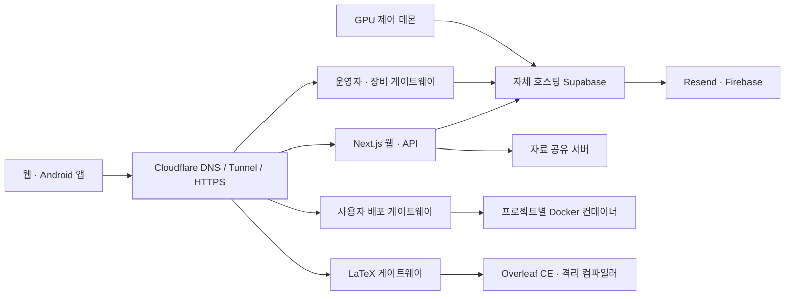

<div align="center">


# CBGPU

**학교생활부터 연구·개발까지, 충북과학고를 위한 통합 플랫폼**

[웹사이트](https://cbgpu.com) · [학생 워크스페이스](https://student.cbgpu.com) · [연구·개발 워크스페이스](https://researcher.cbgpu.com) · [모바일 웹](https://app.cbgpu.com) · [사용 설명서](https://docs.cbgpu.com) · [프리프린트](https://arxiv.cbgpu.com)

Next.js 16 · React 19 · TypeScript · Flutter · PostgreSQL · Docker

</div>

CBGPU는 자습 신청, 시간표, 급식, 자료 공유 같은 학교생활 기능과 GPU 예약, 웹·서버 배포, LaTeX 논문 작성, 제작 신청을 하나의 계정으로 연결합니다. 학생용과 연구·개발용 워크스페이스는 목적에 맞게 기능을 보여주며, 앱에서는 같은 모바일 화면 안에서 모드를 전환합니다.

이 저장소에는 웹 프론트엔드와 API, Android 앱, 자체 호스팅 백엔드, 운영자 콘솔, 배포 실행기, GPU 제어 데몬, 자료 공유 서버가 포함됩니다. 운영 데이터·계정·비밀키·백업은 포함하지 않습니다.

> 아래 이미지는 2026년 11월 4일 운영 사이트를 비로그인 상태로 촬영한 화면입니다. 실제 계정 정보나 관리자 내부 데이터는 포함하지 않았습니다. 화면의 인사말은 접속 시간에 따라 달라집니다.

## 화면 미리보기

### 학교생활 홈

원하는 기능을 카테고리와 검색으로 찾고, 로그인한 사용자는 프로필과 개인 작업을 이어갈 수 있습니다.


### 연구·개발 워크스페이스

GPU, 프론트엔드·서버 배포, LaTeX와 연구 도구를 한곳에서 제공합니다.


### 모바일과 전체 기능 탐색

모바일은 상단 모드 선택과 하단 탐색을 사용합니다. 전체 기능 화면은 즐겨찾기에 없는 서비스도 쉽게 찾도록 구성했습니다.

<table>
<tr>
<td width="30%" align="center"></td>
<td width="70%"></td>
</tr>
</table>

### 공개 문서와 프리프린트

Docs와 arXiv는 독립된 공개 사이트입니다. 문서와 공개 논문은 로그인 없이 열람하며, 논문 업로드에는 CBGPU 계정이 필요합니다.


### 운영자 접근

개발자·관리자·제작 담당자 화면은 사용자 화면과 분리되어 있습니다. 아래는 실제 개발자 콘솔의 로그인 화면이며, 내부 대시보드는 공개 캡처에 포함하지 않았습니다.


## 서비스 주소

| 주소 | 용도 | 접근 |
| --- | --- | --- |
| [cbgpu.com](https://cbgpu.com) | 기본 진입점, 학교생활 홈 | 홈 공개, 기능별 계정 필요 |
| [student.cbgpu.com](https://student.cbgpu.com) | CBGPU for Students | 기능별 계정 필요 |
| [researcher.cbgpu.com](https://researcher.cbgpu.com) | CBGPU for Research & Development | 기능별 계정 필요 |
| `developer.cbgpu.com` | 기존 개발자 이용자 주소 호환 | 연구·개발 워크스페이스로 연결 |
| [app.cbgpu.com](https://app.cbgpu.com) | 모바일 전용 웹, Android 앱의 웹 화면 | 기능별 계정 필요 |
| [docs.cbgpu.com](https://docs.cbgpu.com) | 서비스별 사용 설명서 | 공개 |
| [arxiv.cbgpu.com](https://arxiv.cbgpu.com) | 학교 프리프린트 열람·등록 | 열람 공개, 등록은 로그인 |
| [latex.cbgpu.com](https://latex.cbgpu.com) | Overleaf CE 기반 논문 편집기 | 승인된 계정 |
| [gpu.cbgpu.com](https://gpu.cbgpu.com) | GPU별 Jupyter 진입점 `/1`–`/4` | GPU 서비스 인증·이용 정책 적용 |
| [developers.cbgpu.com](https://developers.cbgpu.com) | CBGPU 개발자 운영 콘솔 | 허용된 개발자 계정 |
| [admin.cbgpu.com](https://admin.cbgpu.com) | 계정·예약·학교 서비스 관리 | 관리자 권한 |
| [print.cbgpu.com](https://print.cbgpu.com) | 3D 프린터 담당자 업무 | 배정된 담당자 권한 |
| [laser.cbgpu.com](https://laser.cbgpu.com) | 레이저 커팅 담당자 업무 | 레이저 담당자 권한 |
| [manufacturing.cbgpu.com](https://manufacturing.cbgpu.com) | 제작 업무 워크스페이스 선택 | 담당자 권한 |
| `<프로젝트>.front.cbgpu.com` | 사용자 프론트엔드 배포 | 프로젝트 공개 설정 적용 |
| `<프로젝트>.server.cbgpu.com` | 사용자 서버 배포 | 프로젝트 공개 설정 적용 |

`developer`는 개발자 **이용자**를 위한 기존 주소이고, `developers`는 CBGPU **운영 개발자**용 콘솔입니다. 별개 서비스입니다. 서브도메인은 DNS·터널·인증서 설정이 있어야 동작하며, 코드를 실행한다고 자동 생성되지는 않습니다.

## 주요 기능

### 학생용

- **자습 신청:** 교실·좌석 현황 조회, 교시·담당 교사·사유 선택, 본인 신청 내역과 취소. 개인 EduSet 계정을 연결하여 공식 명단에 반영합니다.
- **학교생활:** 시간표, 급식, 기상송 신청과 플레이리스트.
- **자료 공유:** 학습·연구 자료 업로드와 다운로드.
- **커뮤니티:** 교내 대회, 스터디 매칭, 투표, 피드, 도구와 아케이드.
- **기능 탐색:** 카테고리, 검색, 최근 이용과 사용자별 바로가기.

### 연구·개발용

- **GPU:** 예약·현황 확인, Jupyter와 SSH 이용 안내.
- **프론트엔드 배포:** Git 저장소·브랜치·하위 폴더·빌드 명령·출력 경로·환경 변수 설정, 빌드 로그, 배포 이력, 공동작업자, 프로젝트 도메인과 커스텀 도메인 연결.
- **서버 배포:** Node.js, Python, Java/Spring Boot, Go, .NET 런타임 및 Docker Compose 배포. 하위 폴더와 실행 설정 수정, 재배포, 상태·로그 확인을 지원합니다. 재배포는 설정된 Git 브랜치의 최신 코드를 가져옵니다.
- **Compose 진단:** 서비스 시작·상태 확인에 실패하면 서비스 상태, 컨테이너 로그와 헬스체크 기록을 수집합니다. 실패를 성공으로 처리하지 않으며 진단을 위해 컨테이너·데이터 볼륨을 보존합니다.
- **LaTeX:** Overleaf Community Edition 기반 편집기, ZIP 프로젝트 가져오기, 메인 문서·컴파일러 선택, 프로젝트 목록과 휴지통 연동. pdfLaTeX·XeLaTeX·LuaLaTeX 등을 지원합니다.
- **연구 기록·공개:** 연구노트, 자료 공유, 프리프린트 등록과 공개 열람.
- **제작:** 3D 프린터와 레이저 커팅 신청, 첨부 파일과 처리 상태 확인.

### 운영·관리용

- 개발자 콘솔: 서버 상태·사용량·방문 통계, 테이블 편집기, SQL 편집기, 서비스 로그, 실제 Bash PTY 터미널.
- 콘솔의 배포 화면: CBGPU 자체 프론트엔드의 배포 정보·로그를 **조회**합니다. 사용자용 프론트엔드 배포 서비스와 구분됩니다.
- 관리자: 계정·승인, GPU·서버·제작 요청과 학교 서비스 관리.
- 제작 담당자: 프린터·레이저 권한을 따로 검증하고, 프린터 작업은 배정된 장비에 따라 분리합니다.
- 이메일: Resend 발송, 로고·버튼을 포함한 HTML 인증·안내 템플릿. 기기 푸시는 Firebase 연동.
- 밝은 테마·어두운 테마와 반응형 레이아웃.

## EduSet 간편 연결

Android **v1.0.7 / build 8**부터 다음 흐름을 지원합니다.

1. CBGPU에 로그인하고 자습 신청에서 **EduSet 로그인**을 선택합니다.
2. 별도의 공식 EduSet 로그인 창에서 본인 학교 계정으로 로그인합니다.
3. CBGPU로 돌아오면 표시된 학생 정보를 확인하고 **이 계정으로 연결**을 선택합니다.
4. 이후 CBGPU 안에서 신청·취소합니다. 공식 학교 신청 시간과 본인 계정의 권한을 따릅니다.

연결 세션은 서버에 암호화해 사용자별로 저장하며, 앱을 다시 켜도 유지됩니다. 학교 세션이 만료되면 재로그인이 필요합니다. EduSet 비밀번호를 CBGPU 서버로 전달하지 않습니다. 이전 앱·브라우저의 최초 연결에는 접힌 메뉴 안의 연결 도우미를 사용할 수 있습니다.

[Android APK 다운로드](https://app.cbgpu.com/downloads/cbgpu-1.0.7.apk) · [웹 다운로드 안내](https://cbgpu.com/download)

APK는 기존 배포와 같은 키로 서명했습니다. 자동화된 연결·권한·화면 검증과 APK 빌드는 통과했지만 실제 휴대폰의 학교 로그인·보안 확인 흐름은 별도 기기 검증이 필요합니다.

## 구조

```text
CBGPU/
├── FrontEnd/
│   ├── cbgpu/                  # Next.js 웹, API, 워크스페이스, 공개 문서
│   │   ├── src/app/            # 페이지·Route Handler
│   │   ├── src/components/     # 서비스별 UI
│   │   ├── src/lib/            # 인증·배포·학교 서비스 공통 로직
│   │   ├── extension/          # EduSet 연결 확장 프로그램
│   │   └── public/downloads/   # APK와 연결 도우미
│   └── cbgpu_app/              # Flutter 앱, 네이티브 브리지·알림·위젯
├── backend/
│   ├── docker-compose*.yml     # 자체 호스팅 Supabase 구성
│   ├── developer/              # 개발자·관리자·장비 담당자 게이트웨이
│   ├── deploy/                 # Git 빌드, 실행기, Compose, 도메인 연결
│   ├── latex/                  # Overleaf 연동, ZIP 처리, 컴파일 격리
│   ├── gpu/                    # GPU 공개 경로 게이트웨이
│   ├── operations/             # 운영·백업 작업
│   ├── sql/                    # 추가 권한·데이터 구조
│   ├── supabase/migrations/    # 기능별 SQL 변경
│   ├── volumes/                # 초기화 SQL, Edge Functions, 메일 템플릿
│   └── scripts/                # 설치·운영·검증 스크립트
├── Daemon/                     # GPU 제어와 작업 동기화
├── MaterialShare/              # 자료 공유 API
├── docs/screenshots/           # README 실제 화면 캡처
└── vercelhtml/                 # 기존 Vercel 주소의 리다이렉트
```



## 기술 구성

| 계층 | 구성 |
| --- | --- |
| 웹 | Next.js 16.4, React 19, TypeScript, Tailwind CSS 4, Radix UI |
| 앱 | Flutter/Dart, WebView, 네이티브 인증 세션·알림·위젯 |
| 데이터·인증 | 자체 호스팅 Supabase, PostgreSQL 17, Auth, REST/RPC, Realtime, Storage, Edge Functions |
| 운영 콘솔 | Node.js, WebSocket, node-pty, xterm |
| 배포 | Docker, Docker Compose, Git, Python·Node.js 실행기 |
| 논문 | Overleaf CE, MongoDB, Redis, TeX Live, 별도 컴파일 브로커 |
| 외부 연동 | Cloudflare, Resend, Firebase, EduSet 및 기능별 API |

현재 백엔드는 이 서버에서 자체 호스팅하는 Supabase 구성을 사용합니다. Supabase Cloud 프로젝트가 필수라는 뜻은 아닙니다. 도메인, 메일, 푸시, 외부 API 등의 제공 조건·요금과 서버 자원 비용은 별개입니다.

## 개발 환경

### 웹

Node.js와 npm이 필요합니다. 배포 게이트웨이는 Node 내장 SQLite를 사용하므로 전체 서버 환경은 Node.js 22 이상을 기준으로 준비하세요.

```bash
git clone https://github.com/lmwmason/CBGPU.git
cd CBGPU/FrontEnd/cbgpu
npm ci
cp .env.example .env.local
# .env.local에 본인 개발 환경의 값을 입력
npm run dev
```

`http://localhost:3000`에서 웹을 실행합니다. 서비스 구성에 따라 호스트 기반 라우팅과 서버 API는 운영 도메인 또는 별도로 준비한 개발 호스트가 필요합니다. 프론트엔드만 실행하면 GPU·배포·자료 공유 등 별도 서버까지 자동으로 시작되지는 않습니다.

환경 변수의 핵심은 다음과 같습니다. 전체 운영 값을 공개 저장소에서 가져오면 안 됩니다.

| 변수 | 용도 |
| --- | --- |
| `NEXT_PUBLIC_SUPABASE_URL` | 브라우저가 접근하는 백엔드 API 주소 |
| `NEXT_PUBLIC_SUPABASE_ANON_KEY` | 브라우저용 공개 키; 실제 권한은 인증과 RLS에서 검증 |
| `SUPABASE_INTERNAL_URL` | 서버 내부 Supabase 주소 |
| `SUPABASE_SERVICE_ROLE_KEY` | 서버 전용 키; 브라우저에 노출 금지 |
| `EDUSET_TOKEN_SECRET` | 학교 연결 세션 암호화 키 |

기능별 이메일·푸시·외부 API 설정은 운영 환경에서 별도로 주입합니다. [프론트엔드 안내](FrontEnd/cbgpu/README.md)와 [백엔드 안내](backend/README.md)를 참고하세요.

### Android 앱

```bash
cd FrontEnd/cbgpu_app
flutter pub get
flutter test test/app_navigation_test.dart test/eduset_login_policy_test.dart
flutter build apk --release
```

Android SDK, Firebase 앱 설정과 릴리스 서명 설정은 로컬에서 준비해야 합니다. keystore, `key.properties`, 서비스 계정 키는 저장소에 넣지 않습니다. 기존 사용자의 앱 위에 업데이트하려면 기존 릴리스 서명 키가 필요합니다. iOS를 포함한 다른 플랫폼의 실제 배포 지원은 별도 설정·검증이 필요합니다.

### 백엔드와 운영

백엔드는 기존 운영 데이터·권한·키·설정에 의존합니다. **새 호스트는 `.env.example` 복사만으로 운영 환경 복원이 완료되지 않습니다.** 초기화 SQL, 기능별 마이그레이션, Storage, 외부 연동과 게이트웨이 설정을 함께 준비하세요.

- [백엔드 개요와 기본 운영](backend/README.md)
- [운영 절차](backend/OPERATIONS.md)
- [개발자·장비 담당자 콘솔](backend/developer/README.md)
- [LaTeX 설치·컴파일·백업](backend/latex/README.md)
- [GPU 데몬](Daemon/README.md)
- [자료 공유 서버](MaterialShare/README.md)

Cloudflare에는 서비스별 DNS와 터널 경로가 필요합니다. 사용자 배포의 여러 단계 서브도메인에는 해당 호스트를 포함하는 인증서도 필요합니다. 운영 서비스는 루프백 바인딩과 게이트웨이를 사용하며, PostgreSQL·Studio·컨테이너 내부 관리 포트를 그대로 공개하지 않습니다.

## 검증

웹의 일반 빌드와 외부 학교에 쓰기를 보내지 않는 자습 신청 계약 검증:

```bash
cd FrontEnd/cbgpu
npm run build
node ../../backend/scripts/verify-study-student.cjs
node --test tests/request-security.test.mjs
```

문서의 기능 누락 검사는 `npm run build`의 `prebuild`에서 실행합니다.

앱 경로와 EduSet 로그인 후보 형식 검증:

```bash
cd FrontEnd/cbgpu_app
flutter test test/app_navigation_test.dart test/eduset_login_policy_test.dart
```

`backend/scripts/verify-*`에는 실제 서비스·임시 계정·Docker를 사용하는 통합 검증도 있습니다. 모든 검증이 순수 단위 테스트인 것은 아니므로, 해당 스크립트의 전제와 정리 동작을 읽고 격리된 환경에서 실행하세요. 화면 캡처만으로 실제 메일 도착·물리 장비 동작·모바일 보안 확인이 검증되는 것은 아닙니다.

## 보안과 데이터

- 사용자 인증과 승인 상태를 서버에서 확인하고, 운영자·장비 담당자 권한을 별도로 검증합니다.
- 데이터 접근에 RLS와 서버 권한 검증을 사용합니다. 공개 API 키가 관리자 권한을 주지는 않습니다.
- 학교 연결 토큰은 사용자별 암호문으로 저장합니다. 다른 사용자에게 반환하지 않습니다.
- 운영자 세션은 보호된 쿠키와 변경 요청 검증을 사용합니다. 터미널은 로그인한 운영자의 서버 권한으로 동작합니다.
- 배포와 TeX 컴파일은 컨테이너·자원 제한을 사용합니다. 전체 호스트 손실에 대비한 별도 외부 백업도 필요합니다.
- 운영 `.env`, 개인 설정, 데이터베이스, 업로드, 백업, keystore와 서비스 계정은 Git에서 제외합니다.
- 실제 계정·비밀번호·개인정보가 담긴 화면은 이 README에 게시하지 않습니다.

## 라이선스와 기여

이 저장소는 소스 공개 상태이며, 별도 최상위 라이선스는 아직 선언하지 않았습니다. 공개 저장소라는 이유만으로 재배포·상업 이용에 관한 권리가 자동 부여되는 것은 아닙니다.

Overleaf CE와 포함된 서드파티 구성 요소는 각각의 라이선스를 따릅니다. Overleaf 연동의 AGPL 및 소스 제공 안내는 [LaTeX README](backend/latex/README.md)와 [LICENSE](backend/latex/LICENSE)를, 터미널 라이브러리는 `backend/developer/static/vendor/`의 라이선스 파일을 확인하세요.

버그를 제보할 때는 서비스 주소, 재현 순서, 기대 동작과 실제 동작을 적어 주세요. 공개 이슈에는 로그인 정보·개인 자료·서버 비밀키를 첨부하지 마세요.
