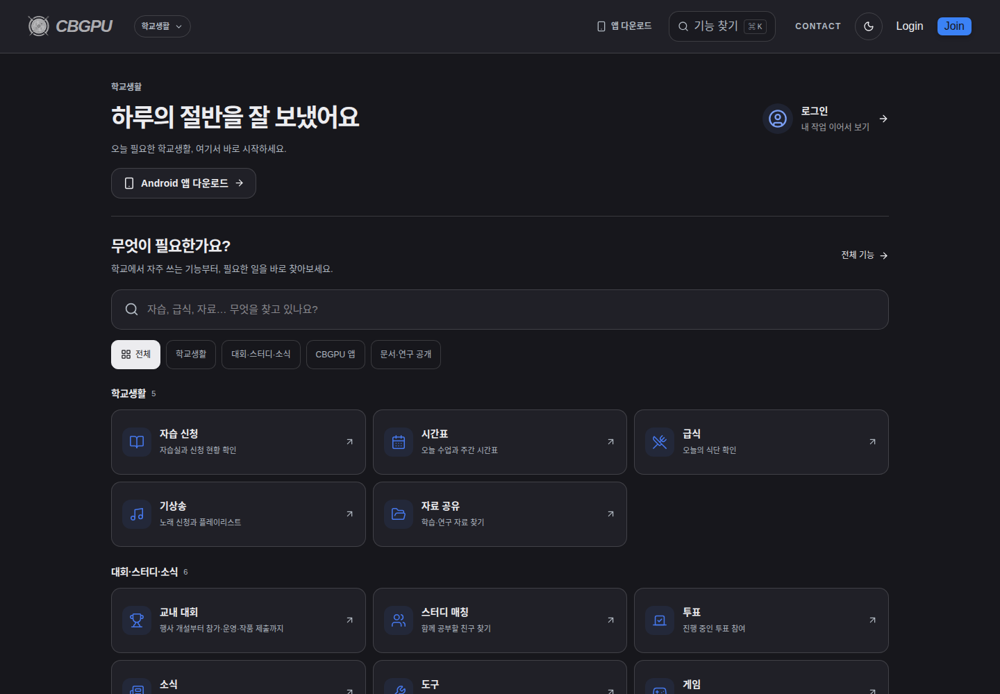
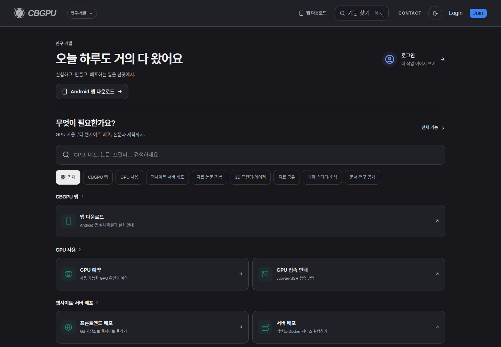
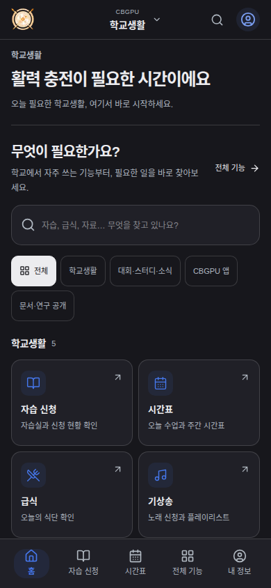
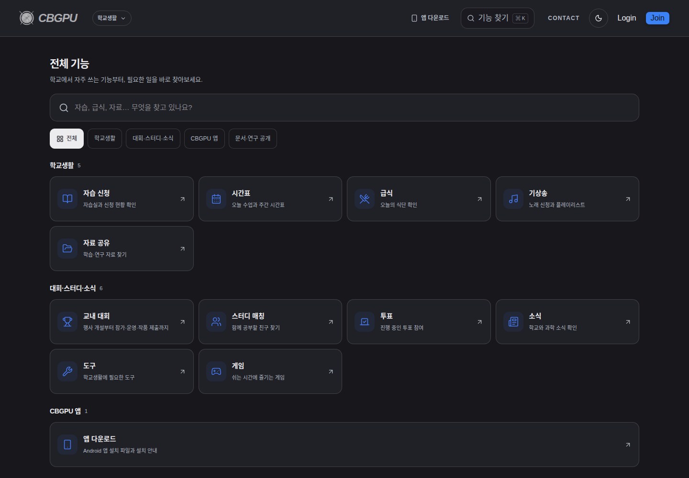
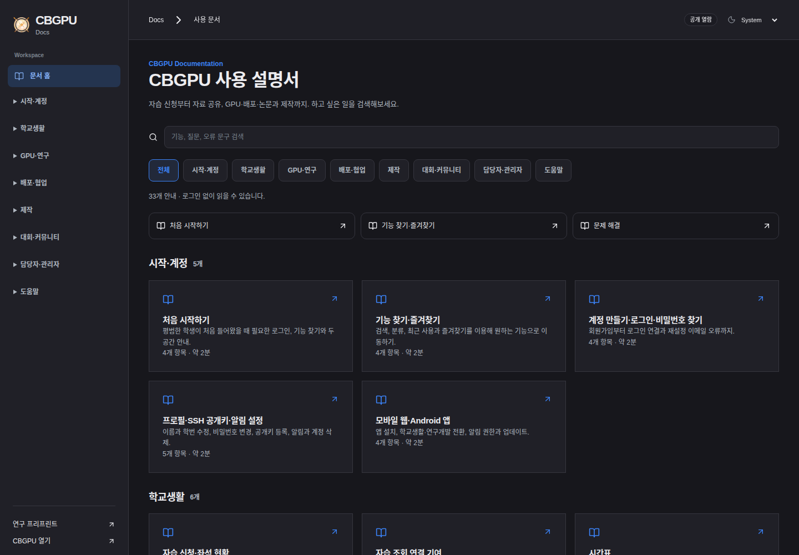
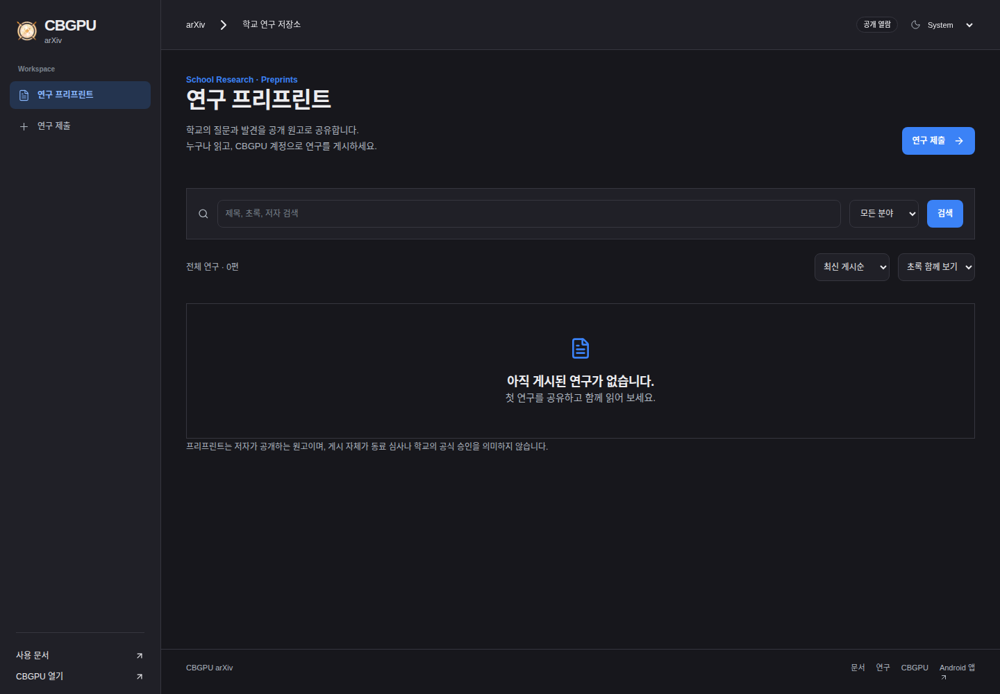
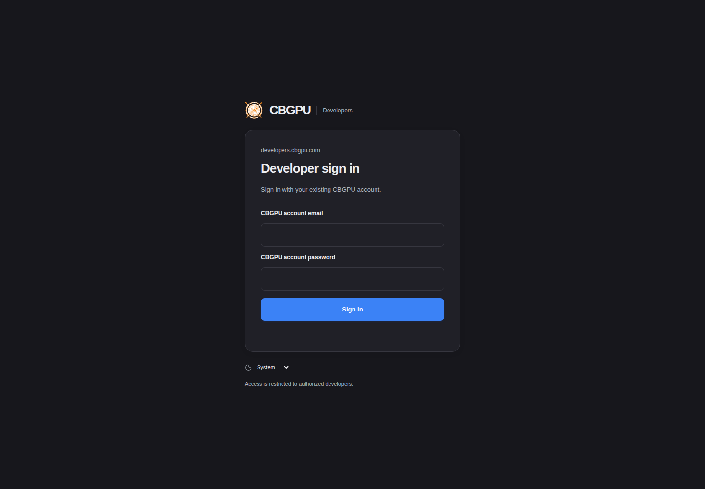

# CBGPU

[](https://github.com/lmwmason/CBGPU/actions/workflows/ci.yml)

[](https://nextjs.org/)
[](https://react.dev/)
[](https://www.typescriptlang.org/)
[](https://flutter.dev/)
[](https://supabase.com/)
[](https://www.docker.com/)
[](./LICENSE)


CBGPU is a school platform for Chungbuk Science High School. Students can apply
for self-study rooms, check their timetable and meals, share materials and join
school activities. Researchers and developers can reserve GPUs, deploy websites
and backend services, write LaTeX papers and request 3D printing or laser cutting.
The web and Android app use the same CBGPU account.

The repository holds the parts that run the service:

- **Web application** — Next.js pages and APIs, with student and research &
  development workspaces. The mobile site has its own navigation and layout.
- **Android app** — a Flutter WebView shell with native session persistence,
  notifications, home-screen widgets and the official EduSet login bridge.
- **Backend** — self-hosted Supabase for PostgreSQL, authentication, REST/RPC,
  Realtime, Storage and Edge Functions. Email uses Resend; device push uses Firebase.
- **Deployment service** — Git-based frontend builds and backend runtimes,
  including Docker Compose, project domains, logs and collaborators.
- **Research tools** — an Overleaf Community Edition integration, research notes,
  shared materials and a public school preprint repository.
- **Operations** — separate developer, administrator, printer-manager and
  laser-manager portals, plus the GPU controller and materials API.

[Website](https://cbgpu.com) · [Mobile web](https://app.cbgpu.com) ·
[Documentation](https://docs.cbgpu.com) · [Preprints](https://arxiv.cbgpu.com) ·
[Download Android app](https://cbgpu.com/download)

## Screenshots

These are screenshots of the running websites, taken on November 4, 2026 while
signed out. The mobile image is a mobile browser capture. No private account or
operator dashboard data is shown.

### Student workspace

The home page groups services by task, with search, a complete service catalogue
and time-sensitive greetings. Signed-in users can continue their own work and
customize shortcuts for their workspace.



### Research & development workspace

GPU access, deployment, writing and fabrication tools share one workspace.



### Mobile app layout

The mobile site keeps the workspace selector at the top and the main navigation
at the bottom. The Android app loads this same mobile interface.



### Service catalogue

Services remain discoverable even when they are not in the user's shortcuts.



### Documentation and preprints

Docs and the school preprint repository are separate public sites. Reading does
not require an account; submitting a paper does.





### Developer portal

Operator portals have a separate sign-in and interface. This is the developer
sign-in page; internal tables, terminals and account data are not shown here.



The full capture list, source URLs and viewport sizes are in
[`docs/screenshots/`](./docs/screenshots/README.md).

## Features

### School life

- **Self-study rooms** — room and seat maps, period and teacher selection,
  application reasons, personal applications and cancellation. A connected
  personal EduSet session writes to the official application list during the
  school's application window.
- **Timetable and meals** — daily and weekly school information.
- **Wake-up music** — song requests and playlists.
- **Shared materials** — upload, browse and download learning and research files.
- **School activities** — contests, study matching, polls, a feed, tools and games.

### Research & development

- **GPU reservations** — availability, reservations and Jupyter/SSH access guidance.
- **Frontend deployment** — select a Git repository, branch and root directory;
  configure the build command, output directory and environment variables; inspect
  logs and deployment history. Projects support collaborators, generated URLs and
  custom domain configuration.
- **Server deployment** — Node.js, Python, Java/Spring Boot, Go and .NET presets,
  alongside Docker Compose projects. Settings can be edited after creation.
  Redeployment fetches the latest code from the configured branch.
- **Compose diagnostics** — failed startup and readiness checks collect service
  status, container logs and health-check output. Failed containers and data
  volumes remain available for diagnosis.
- **LaTeX** — import a ZIP project into Overleaf CE, select the main document and
  compiler, edit and compile it, and manage the project list and trash. Supported
  engines include pdfLaTeX, XeLaTeX and LuaLaTeX. The adapter and compile limits
  are documented in [`backend/latex/`](./backend/latex/README.md).
- **Research records** — notes, shared materials and public preprint submissions.
- **Fabrication** — 3D printing and laser-cutting requests with attachments and
  processing status.

### Administration

- **Developer console** — host health, resource usage, visitor statistics, a table
  editor, SQL editor, service logs and a real Bash PTY terminal.
- **Deployment monitoring** — the developer console shows the CBGPU website's
  release information and logs. Its deployment page is read-only; user frontend
  deployment is a separate service.
- **Admin portal** — accounts, approvals, GPU/server requests and school services.
- **Equipment portals** — printer and laser roles are checked independently.
  Printer jobs are separated by the manager's assigned printer.
- **Email and notifications** — Resend delivery with HTML templates containing
  branding and action buttons, plus Firebase device push.

## Sites and routing

| Address | Purpose |
| ------- | ------- |
| [cbgpu.com](https://cbgpu.com) | Main entry point; defaults to the student workspace |
| [student.cbgpu.com](https://student.cbgpu.com) | CBGPU for Students |
| [researcher.cbgpu.com](https://researcher.cbgpu.com) | CBGPU for Research & Development |
| `developer.cbgpu.com` | Compatibility address for the combined research & development workspace |
| [app.cbgpu.com](https://app.cbgpu.com) | Mobile web and the Android app's web interface |
| [docs.cbgpu.com](https://docs.cbgpu.com) | Public service documentation |
| [arxiv.cbgpu.com](https://arxiv.cbgpu.com) | Public school preprints; account required for submission |
| [latex.cbgpu.com](https://latex.cbgpu.com) | Overleaf CE editor for approved accounts |
| [gpu.cbgpu.com](https://gpu.cbgpu.com) | GPU Jupyter entry points at `/1` through `/4` |
| [developers.cbgpu.com](https://developers.cbgpu.com) | Restricted CBGPU developer console |
| [admin.cbgpu.com](https://admin.cbgpu.com) | Site administration |
| [print.cbgpu.com](https://print.cbgpu.com) | Printer-manager workspace |
| [laser.cbgpu.com](https://laser.cbgpu.com) | Laser-manager workspace |
| [manufacturing.cbgpu.com](https://manufacturing.cbgpu.com) | Equipment workspace selector |
| `<project>.front.cbgpu.com` | User frontend deployments |
| `<project>.server.cbgpu.com` | User server deployments |

`developer.cbgpu.com` is an address for people using the research and development
services. `developers.cbgpu.com` is the restricted console for people maintaining
CBGPU. Access to protected services depends on account approval and service roles.

Host-based routes need the corresponding DNS, tunnel and TLS configuration.
Running the source alone does not provision those domains. Nested deployment
subdomains also need a certificate that covers their hostnames.

## Tech stack

- **Web:** Next.js 16.4, React 19, TypeScript, Tailwind CSS 4 and Radix UI.
- **Android:** Flutter/Dart, WebView, native authentication-session persistence,
  notifications and home-screen widgets.
- **Data and authentication:** self-hosted Supabase with PostgreSQL 17, Auth,
  REST/RPC, Realtime, Storage and Edge Functions.
- **Operator console:** Node.js, WebSocket, node-pty and xterm.
- **Deployment:** Git, Docker, Docker Compose, and Python/Node.js workers.
- **LaTeX:** Overleaf CE, MongoDB, Redis, TeX Live and a separate compile broker.
- **External services:** Cloudflare for public routing, Resend for email,
  Firebase for push, and EduSet for official school applications.

## Contributing

Start with the [local demo](./docs/DEVELOPMENT.md), then read
[CONTRIBUTING.md](./CONTRIBUTING.md). Bug and feature issue forms and a PR template
are provided. Participation follows the [code of conduct](./CODE_OF_CONDUCT.md).
Report vulnerabilities privately using [SECURITY.md](./SECURITY.md).

[Releases](https://github.com/lmwmason/CBGPU/releases) include source packages and
checksums. Android uses separate `android-vX.Y.Z` releases. See
[CHANGELOG.md](./CHANGELOG.md), [release procedures](./docs/RELEASING.md),
[third-party notices](./THIRD_PARTY_NOTICES.md) and the
[dependency inventory](./docs/DEPENDENCIES.md).

## Try the local demo

No school account or production services are needed:

```bash
cd FrontEnd/cbgpu
npm ci
npm run demo
```

Open `http://localhost:3100`. Sign in with `student@example.invalid` or
`researcher@example.invalid`, password `demo-only`. The existing web UI runs
against synthetic in-memory auth, school applications and GPU data. Unsupported
integrations return a demo response; no real school, email, equipment or deployment
operation is forwarded. See [development setup](./docs/DEVELOPMENT.md) and the
[school configuration guide](./docs/SELF_HOSTING.md).

## Getting started

### Web application

Install Node.js and npm. The deployment gateway uses Node's built-in SQLite API;
use Node.js 22 or newer when preparing the complete server environment.

```bash
git clone https://github.com/lmwmason/CBGPU.git
cd CBGPU/FrontEnd/cbgpu
npm ci
cp .env.example .env.local
```

Set the values in `.env.local`, then start the development server:

```bash
npm run dev
```

The web application opens at `http://localhost:3000`. Production routing selects
pages by hostname, so some routes need an appropriate development host setup.
Starting Next.js does not also start the GPU controller, deployment workers,
materials API or other backend services.

| Variable | Purpose |
| -------- | ------- |
| `NEXT_PUBLIC_SUPABASE_URL` | Backend API URL reachable by the browser |
| `NEXT_PUBLIC_SUPABASE_ANON_KEY` | Public client key; authentication and RLS enforce access |
| `SUPABASE_INTERNAL_URL` | Supabase address used by server-side code |
| `SUPABASE_SERVICE_ROLE_KEY` | Server-only privileged key |
| `EDUSET_TOKEN_SECRET` | Private key material for school-session encryption |

Feature-specific email, push and external API credentials are configured
separately on the server. Keep real environment files out of Git.

To build the web application:

```bash
npm run build
npm start
```

The build also checks that the documentation covers the service catalogue.
See [`FrontEnd/cbgpu/`](./FrontEnd/cbgpu/README.md) for additional feature notes.

### Android app

The easiest way to install the app is the
[download page](https://cbgpu.com/download). The EduSet login bridge was introduced
in **v1.0.7 / build 8**; its
[signed APK](https://github.com/lmwmason/CBGPU/releases/download/android-v1.0.7/cbgpu.apk) is available directly.

To build from source, install Flutter and the Android SDK:

```bash
cd FrontEnd/cbgpu_app
flutter pub get
flutter test test/app_navigation_test.dart test/eduset_login_policy_test.dart
flutter build apk --release
```

Prepare the Firebase app configuration and release signing settings locally.
Signing keystores, `key.properties` and service-account credentials are not part
of the repository. An update installed over an existing release must use the
same signing key. Other platform targets need their own setup and device testing.

### EduSet connection

1. Sign in to CBGPU and choose **EduSet login** in the self-study service.
2. Sign in to the official EduSet page opened by the Android app.
3. Return to CBGPU, check the displayed student identity and confirm the connection.
4. Apply or cancel inside CBGPU during the official school application window.

The backend encrypts the personal connection and stores it against the CBGPU
user, so reopening the app does not require another setup. School-session expiry
requires another login. EduSet passwords are entered on the official school page,
not sent to the CBGPU server. Older apps and browsers have a connection-helper
fallback under the expanded setup menu.

### Backend and operations

The backend runs Supabase on the host. A Supabase Cloud project is not required
for that setup. Hosting resources, domains and external email, push and API
services still have their own resource limits and terms.

A fresh host needs generated secrets, the database schema and feature migrations,
Storage configuration and the service gateways. Copying `.env.example` does not
restore an existing installation's accounts or data.

| Component | Setup and operations |
| --------- | -------------------- |
| Backend stack | [`backend/README.md`](./backend/README.md) |
| Operational procedures | [`backend/OPERATIONS.md`](./backend/OPERATIONS.md) |
| Developer and equipment portals | [`backend/developer/README.md`](./backend/developer/README.md) |
| LaTeX, compilation and backups | [`backend/latex/README.md`](./backend/latex/README.md) |
| GPU controller | [`Daemon/README.md`](./Daemon/README.md) |
| Materials API | [`MaterialShare/README.md`](./MaterialShare/README.md) |

Public traffic goes through service gateways and Cloudflare Tunnel. PostgreSQL,
Studio and internal container management ports stay private. Production data,
uploads, environment files and backups are excluded from this repository.

## Project structure

```text
FrontEnd/
  cbgpu/                         Next.js web application and API
    src/app/                     Pages and Route Handlers
    src/components/              Service and workspace interfaces
    src/lib/                     Authentication, routing and service logic
    extension/                   EduSet connection extension
    public/downloads/            School helpers; APKs are operator-managed/ignored
  cbgpu_app/                     Flutter app and native bridge
    lib/core/                    Navigation, sessions, EduSet login and notifications
    test/                        App navigation and school-session tests
backend/
  docker-compose*.yml            Self-hosted Supabase stack and overrides
  developer/                     Developer, admin and equipment gateways
  deploy/                        Git builds, runtimes, Compose and domain management
  latex/                         Overleaf integration, ZIP import and compile broker
  gpu/                           Public GPU route gateway
  operations/                    Operational and backup jobs
  sql/                           Additional schema and access controls
  supabase/migrations/            Feature migrations
  volumes/                       Initialization SQL, Edge Functions and mail templates
  scripts/                       Setup, operations and verification scripts
Daemon/                          GPU controller and job synchronization
MaterialShare/                   Materials file API
docs/screenshots/                Website captures used in this README
design-research/                 UI reference notes
vercelhtml/                      Redirect from the previous Vercel entry point
```

## Tests and status

From `FrontEnd/cbgpu`, run the build and the isolated request-security and school
application checks:

```bash
npm run build
node --test tests/request-security.test.mjs
node ../../backend/scripts/verify-study-student.cjs
```

The school contract test uses fixtures. It checks identity validation, ownership,
application windows, request payloads, duplicate protection and connection
persistence without writing to the school's live application list.

From `FrontEnd/cbgpu_app`, run the navigation and EduSet session-policy tests:

```bash
flutter test test/app_navigation_test.dart test/eduset_login_policy_test.dart
```

`backend/scripts/verify-*` also contains integration checks that may create
short-lived local accounts, tables or containers. Read their prerequisites and
cleanup behavior before running them against a live installation.

The web build, request-security tests, school contract checks and Android build
have passed. The native login bridge has automated policy and simulated UI
coverage; the real phone login and school security challenge still need an
end-to-end device check. Actual email receipt, push delivery and physical GPU or
fabrication jobs require their own live verification.

## Data and access

Account approval, service roles and ownership are checked on the server. RLS
protects client database access. School connections are encrypted per user;
operator sessions use protected cookies and mutation checks. The console terminal
runs with the operator service's host permissions.

Deployments and TeX compilation use containers and resource limits. The LaTeX
compile broker's limits and isolation model are described in its README. Keep an
independent off-host backup: local backups alone do not protect against losing
the host's disk.

Do not commit production environment files, database exports, uploaded documents,
signing keys or service-account credentials. When reporting an issue, include
the affected service, reproduction steps and expected behavior, and remove
private account details from screenshots.

## License

CBGPU's original code is licensed under the [Apache License 2.0](./LICENSE),
except where a component carries a separate license. See [NOTICE](./NOTICE)
for attribution and component notices.

The LaTeX integration under `backend/latex/` retains its
[GNU Affero General Public License 3.0](./backend/latex/LICENSE).
Overleaf CE and other third-party components retain their respective licenses.
See the [Overleaf integration notes](./backend/latex/README.md) and the terminal
library license files in
[`backend/developer/static/vendor/`](./backend/developer/static/vendor/).
